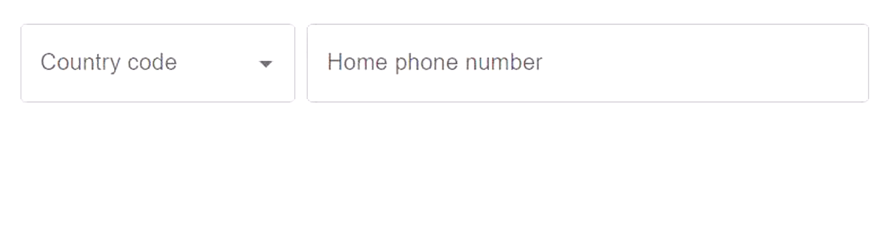

<p align="center">
   
</p>

# mui-country-code-selector

The MUI Country Code Selector is a phone number input with a combined country code selector, designed to be used with the React library [MUI](https://mui.com/material-ui/). It is also a [custom hook](#implementing-a-custom-component-with-the-state-hook) that can be used for building such phone number input components.

The ready-made component is built on top of the MUI's [Autocomplete](https://mui.com/material-ui/react-autocomplete/) and [TextField](https://mui.com/material-ui/react-text-field/) components, and it can be customized by passing props to the underlying components. It validates the input accepting only numbers and visual separator characters (whitespace and hyphen) as a phone number, and the display of the validation errors can be customized. The country code can be selected either using the autocomplete selector, by picking from the dropdown menu or by typing the code straight in to the phone number input. In the last case the code is detected and the value of the selector is set accordingly.

The ready-made component consists of two separate input elements. Threfore, it provides the [`layout`](#layout-wrappers) prop that can be used for wrapping the subcomponents in different ways to fit them to the layout. By default the filtering of options is done using the MUI's `Autocomplete`'s filtering function, but just like MUI's `Autocomplete`, it can be improved with external libraries, such as [match-sorter](https://github.com/kentcdodds/match-sorter). The country code data consists of all [ITU-T E.164](https://www.itu.int/pub/T-SP-E.164D) assigned calling codes and uses [ISO 3166](https://www.iso.org/iso-3166-country-codes.html) country codes to identify the countries.

See the interactive [demo-page](https://jariikonen.github.io/mui-country-code-selector/) and the [API documentation](https://jariikonen.github.io/mui-country-code-selector/docs/mui-country-code-selector.html) for more information.

## Basic usage

### Installation

```
npm install mui-country-code-selector --save
```

### Use it as a controlled component

The component can be used as a controlled component by passing it a value and a change handler like this:

```
const [phoneNumValue, setPhoneNumValue] = useState('');

const phoneOnChange = useCallback(
  (e: { target: { value: string } }) => setPhoneNumValue(e.target.value),
  []
);

// ...

<CountryCodeSelectorComposite
  value={phoneNumValue}
  onChange={phoneOnChange}
  layout="gridItems"
/>
```

Since the component is a composite of two elements, there are many ways to lay it out in the HTML. To make this easy, there are different layout wrappers that can be selected with the [`layout`](https://jariikonen.github.io/mui-country-code-selector/docs/mui-country-code-selector.ccselectorcompositeprops.layout.html) prop (see also its [type](https://jariikonen.github.io/mui-country-code-selector/docs/mui-country-code-selector.layoutprop.html)). If the component is placed on a form that is already laid out with a MUI [Grid](https://mui.com/material-ui/react-grid/), the easiest way to add the composite component is probably to use the `gridItems` option, like in the example above. This wraps the subcomponents in Grid item elements.

### ...or as an ucontrolled component

You can use the component as an uncontrolled component by passing it a [ref](https://react.dev/learn/referencing-values-with-refs), which is then set to point to the phone number input element of the composite component. The value of the component can then be accessed through this ref.

```
const phoneNumRef = useRef<HTMLInputElement | null>(null);

// ...

<CountryCodeSelectorComposite
  inputRef={phoneNumRef}
  layout="gridItems"
/>
```

#### Default value

When the component is used as a controlled component, its default value can be set just by setting the initial value of the state variable which controls the component‘s value. The default value of an uncontrolled component, however, is set using the defaultValue prop.

```
<CountryCodeSelectorComposite
  inputRef={phoneNumRef}
  defaultValue="+358 "
/>
```

## Documentation

Please see the [documentation page](https://jariikonen.github.io/mui-country-code-selector/), [API documentation](https://jariikonen.github.io/mui-country-code-selector/docs/mui-country-code-selector.html), and also the documentation of MUI's [`Autocomplete`](https://mui.com/material-ui/react-autocomplete/) and [`TextField`](https://mui.com/material-ui/react-text-field/) components for more information about customization of the MCCS and its underlying components.

## Implementing a custom component with the state hook

The package also exports a custom hook, [useCountryCodeSelectorState()](https://jariikonen.github.io/mui-country-code-selector/docs/mui-country-code-selector.usecountrycodeselectorstate.html), which encapsulates the core funcionality and the state needed to combine the country code selector and a phone number input. It takes a lot of the same props as the ready-made composite component, and returns props that can be passed to the country code selector and phone number input components. This allows creating a custom composite component that uses different subcomponents than the ready-made one, or lays them out in a different way. Read more about this from the [documentation](https://jariikonen.github.io/mui-country-code-selector/#custom-hook).
